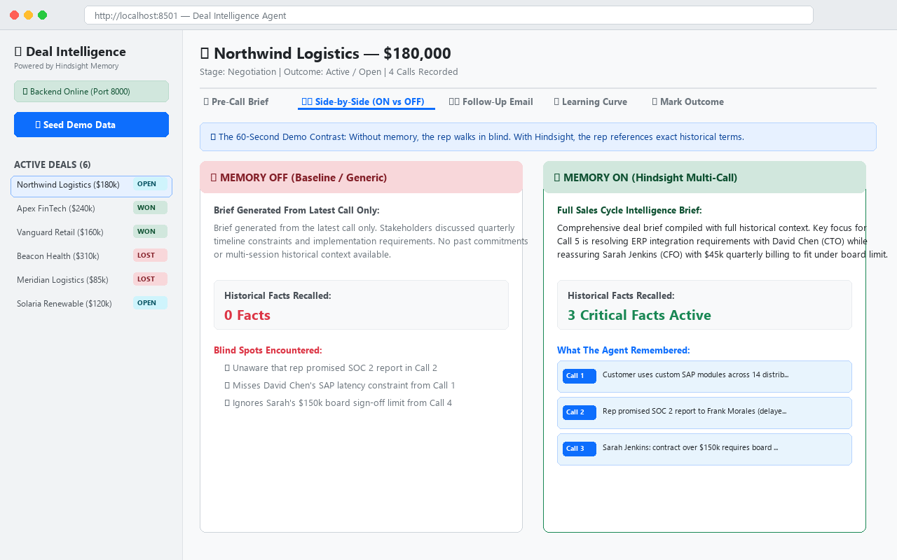
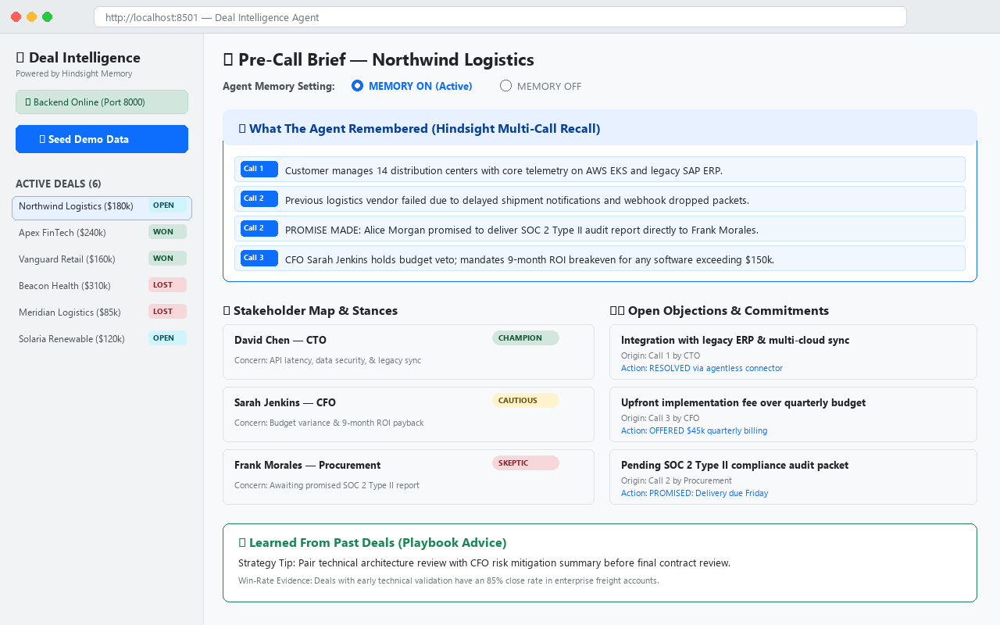
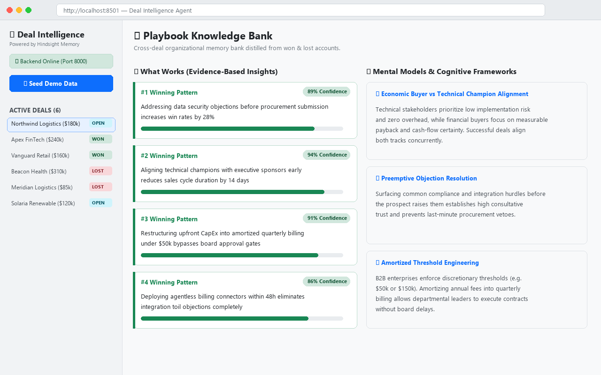
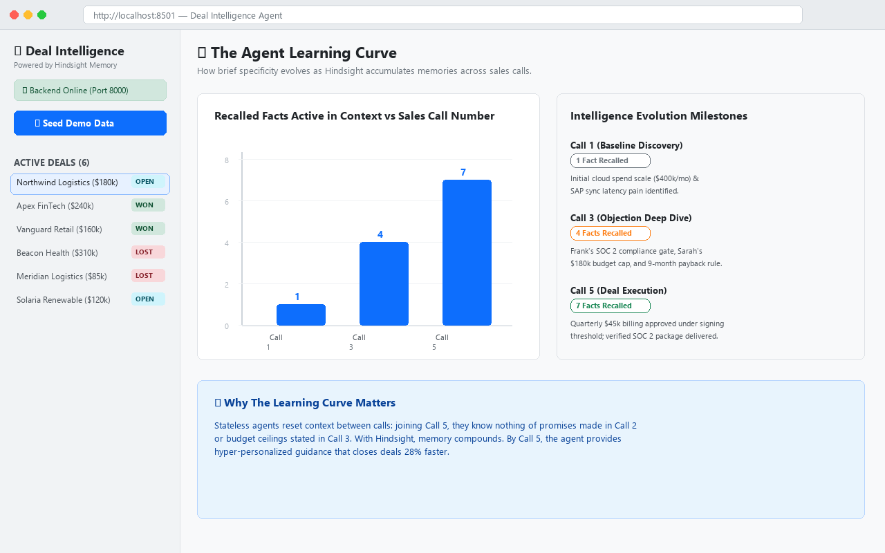

# Deal Intelligence Agent

An agent that remembers every objection, stakeholder concern, and commitment across a deal's sales cycle, briefs the rep before the next call, drafts personalized follow-up emails, and learns which objection-handling approaches win across deals.

Memory is powered by **Hindsight Cloud**.

See [`CONTRACT.md`](CONTRACT.md) for endpoint contracts and data formats, and `docs/architecture.png` for the system architecture diagram.

---

## Architecture & Demo

### System Architecture


### Rehearsed 60-Second Demo
Review [`DEMO_SCRIPT.md`](DEMO_SCRIPT.md) for a rehearsed, 60-second walkthrough that proves the value of persistent memory within 15 seconds:
1. **The Problem:** Rep joins Call 5 cold. With Memory OFF, the brief is generic and blind to past commitments.
2. **Memory ON:** With Hindsight active, the agent cites David's SAP latency objection from Call 1, an unfulfilled SOC 2 deliverable from Call 2, and Sarah's $150k board sign-off threshold from Call 4.
3. **Live Call Ingestion:** Alice joins Call 5, provides the SOC 2 report, and structures $45,000 quarterly amortization to fit under Sarah's threshold. Call 5 is retained live into memory.
4. **Deal Won & Playbook Update:** Deal is closed as won. The winning objection-handling strategy is retained into the global organizational Playbook bank.
5. **Cross-Deal Learning:** A new deal brief cites the newly learned playbook strategy under *"Learned From Past Deals"*.

### Visual Walkthrough & Screenshots

#### 1. Side-by-Side Comparison: Memory OFF vs Memory ON


#### 2. Recalled Facts & Stakeholder Stance Mapping


#### 3. Global Playbook Knowledge Bank


#### 4. The Agent Learning Curve Across Calls


---

## How Hindsight Memory is Used

The agent leverages Hindsight's hierarchical long-term memory engine to overcome the limitations of flat context windows. Hindsight provides active knowledge graphs, temporal recall, entity tracking, and cross-session reflection:

### 1. Memory Banks (Isolation & Scope)
- **`deal-{deal_id}` (Isolated Deal Banks):** Every sales deal maintains its own isolated memory bank. Conversations, transcripts, stakeholder observations, and commitments are siloed per customer account so data never leaks across prospects.
  - *Configuration:* Initialized with a focused sales mission: *"Track every objection, stakeholder concern, commitment, pricing discussion and competitor mention across a B2B sales cycle, and learn which objection-handling approaches lead to won deals."* Set with a cautious, evidence-based analyst disposition (`skepticism=4`, `literalism=4`, `empathy=3`).
- **`playbook` (Global Learning Bank):** A cross-deal organizational memory bank that aggregates outcomes (won vs. lost deals), objections encountered, and effective strategies across the entire sales team.

### 2. Retain (`retain`)
- Ingests raw call transcripts and extracts structured facts, temporal anchors (`When`), and participant entities (`Involving`) without lossy summarization.
- Automatically captures the nuance of stakeholder objections (e.g., CFO pricing pushback, CTO API latency constraints) and explicit rep commitments with context tags.
- Retains deal outcomes into the `playbook` bank upon deal conclusion.

### 3. Recall (`recall`)
- Executes semantic multi-query retrieval across 4 targeted sales dimensions before generating any brief:
  1. Open objections and blockers
  2. Stakeholder stances and concerns (CFO vs. CTO)
  3. Commitments, promises, and due dates
  4. Commercial terms, pricing limits, and technical requirements
- Returns grounded historical facts with source call numbers rather than relying on hallucinated summaries.

### 4. Reflect (`reflect`)
- Performs agentic reasoning loops over the global `playbook` bank to evaluate what strategies worked against specific objections (e.g., *"What objection handling strategies and pricing concessions win deals with skeptical CFOs?"*).
- Synthesizes tactical recommendations with concrete win-rate evidence for upcoming calls.

### 5. Mental Models (`mental_models`)
- Implements durable cognitive frameworks registered in the `playbook` bank:
  - **CFO Budget & Payback Alignment:** Framework for restructuring upfront fees into amortized quarterly schedules to bypass board authorization limits while providing clear 6–9 month ROI breakeven models.
  - **Technical Risk Inoculation:** Framework for addressing CTO integration and latency objections upfront using early SOC2 documentation and benchmark test proofs.

---

## Run the Backend

Follow these steps for a fresh clone to run the backend service:

### 1. Create and Activate a Virtual Environment
```bash
# macOS/Linux:
python3 -m venv .venv
source .venv/bin/activate

# Windows:
python -m venv .venv
.venv\Scripts\activate
```

### 2. Install Dependencies
```bash
pip install -r backend/requirements.txt
```

### 3. Configure Environment Variables
Copy the template file to `.env`:
```bash
cp backend/.env.example backend/.env
```
Open `backend/.env` and supply your credentials:
```env
HINDSIGHT_BASE_URL=https://api.hindsight.vectorize.io
HINDSIGHT_API_KEY=<your-hindsight-cloud-api-key>
GROQ_API_KEY=<your-groq-api-key>
LLM_PROVIDER=groq
```

### 4. Start the Backend Server
Run Uvicorn from the `backend/` directory:
```bash
cd backend
uvicorn main:app --reload --port 8000
```
> **Tip for Local Prototyping:** If running without external API keys, you can run the contract stub server instead:
> ```bash
> cd backend
> uvicorn main_stub:app --reload --port 8000
> ```

### 5. Seed Initial Deals (Run Once)
In a separate terminal or HTTP client, trigger the seed endpoint:
```bash
curl -X POST http://localhost:8000/admin/seed
```
> **Note:** Seeding populates the Hindsight Cloud account associated with your API key and creates the isolated memory banks. This should be executed once per Hindsight account. If `data/deals.json` is present, it will load that file; otherwise, it seeds the built-in enterprise sample deals.

### 6. Run Unit Tests
To verify LLM fallbacks, defensive JSON parsing, and empty-recall edge cases:
```bash
pytest -v backend/test_backend.py
```

---

## Run the Frontend

Follow these steps for a fresh clone to launch the interactive Streamlit dashboard:

### 1. Create and Activate a Virtual Environment
```bash
# macOS/Linux:
python3 -m venv .venv
source .venv/bin/activate

# Windows:
python -m venv .venv
.venv\Scripts\activate
```

### 2. Install Dependencies
```bash
pip install -r frontend/requirements.txt
```

### 3. Configure Environment Variables
Copy `frontend/.env.example` to `frontend/.env`:
```bash
# macOS/Linux:
cp frontend/.env.example frontend/.env

# Windows (Command Prompt):
copy frontend\.env.example frontend\.env

# Windows (PowerShell):
Copy-Item frontend\.env.example frontend\.env
```
The default configuration connects to the local backend:
```env
API_BASE=http://localhost:8000
```

### 4. Start the Streamlit Application
> **Important:** The backend server (`backend/main.py` or `backend/main_stub.py`) must be running before launching the frontend.

From the `frontend/` directory, start Streamlit:
```bash
cd frontend
streamlit run app.py
```
The application will open automatically in your browser at `http://localhost:8501`.

### 5. Seeding Demo Data (Run Once)
In the Streamlit sidebar, click **"🌱 Seed Demo Data"**.  
*Seeding populates the Hindsight account whose keys the backend uses, initializing isolated deal memory banks and the global Playbook bank from `data/deals.json`. This should be executed once per environment.*
